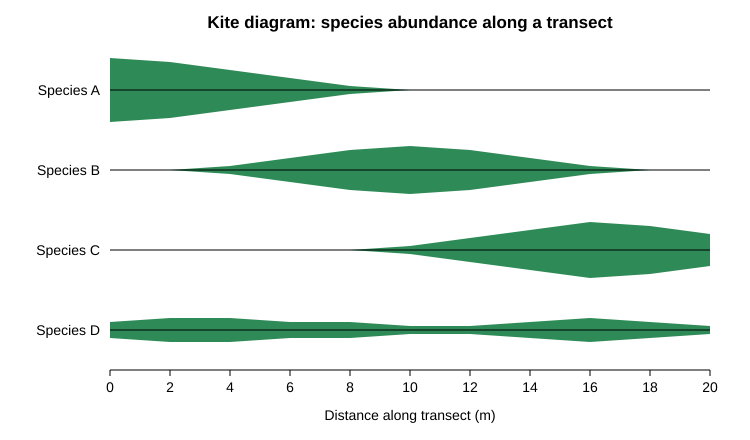
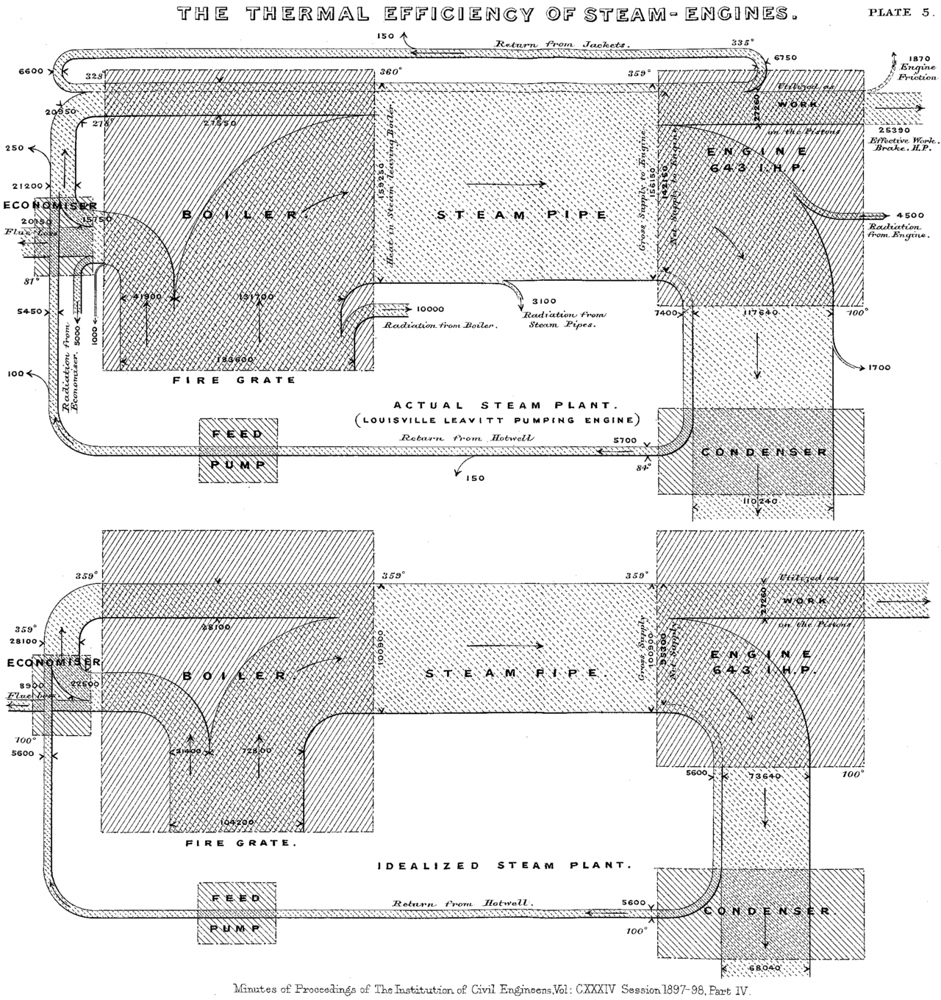
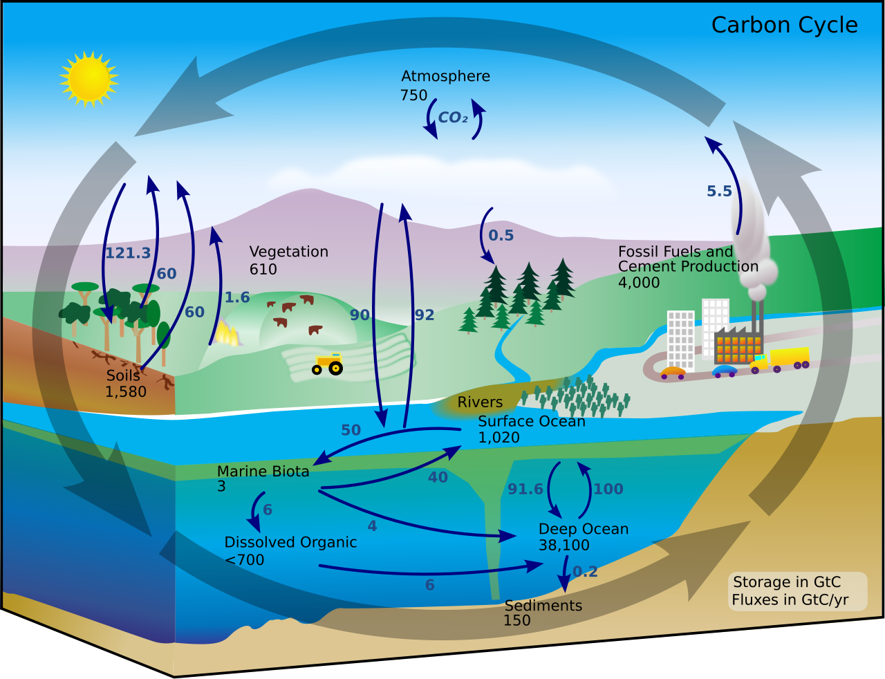
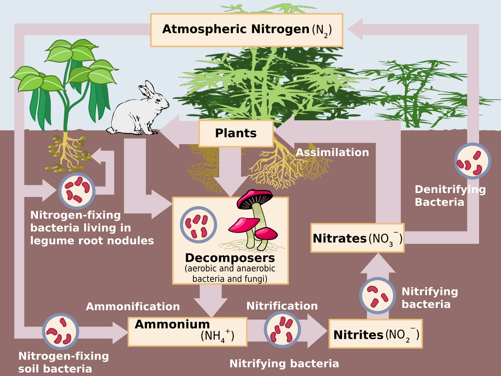
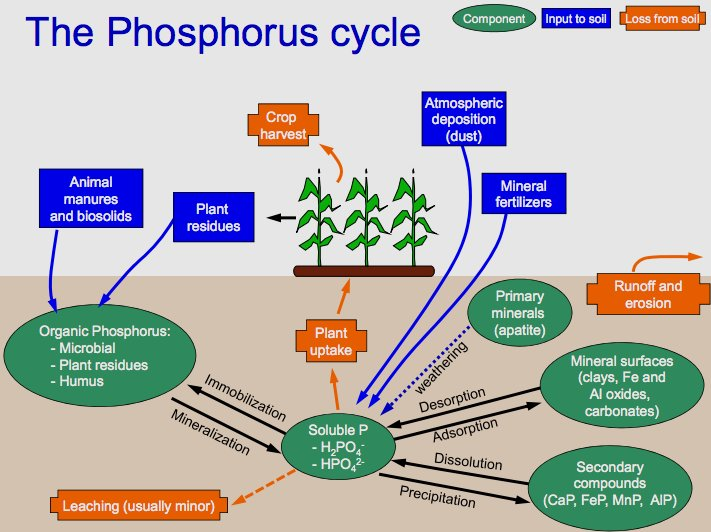
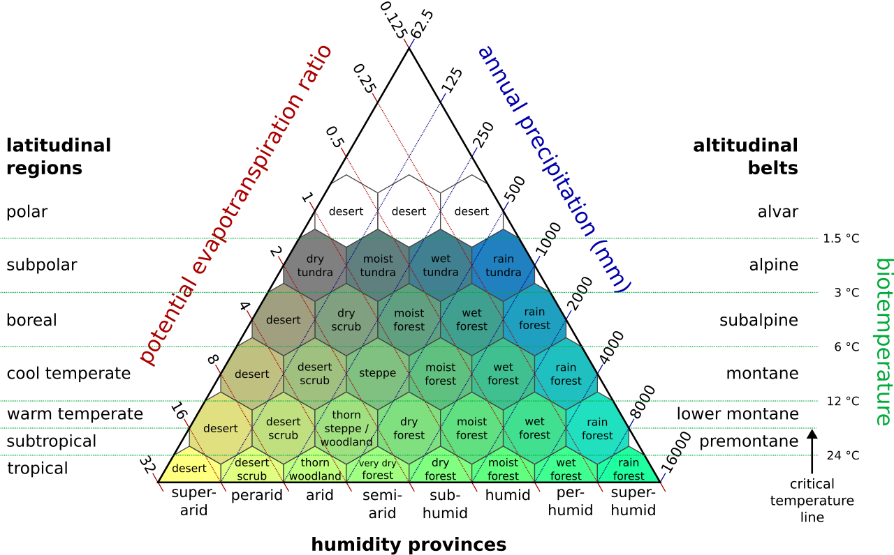
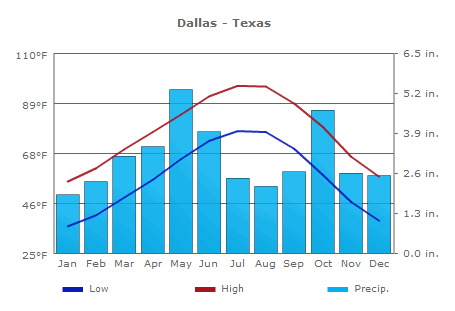
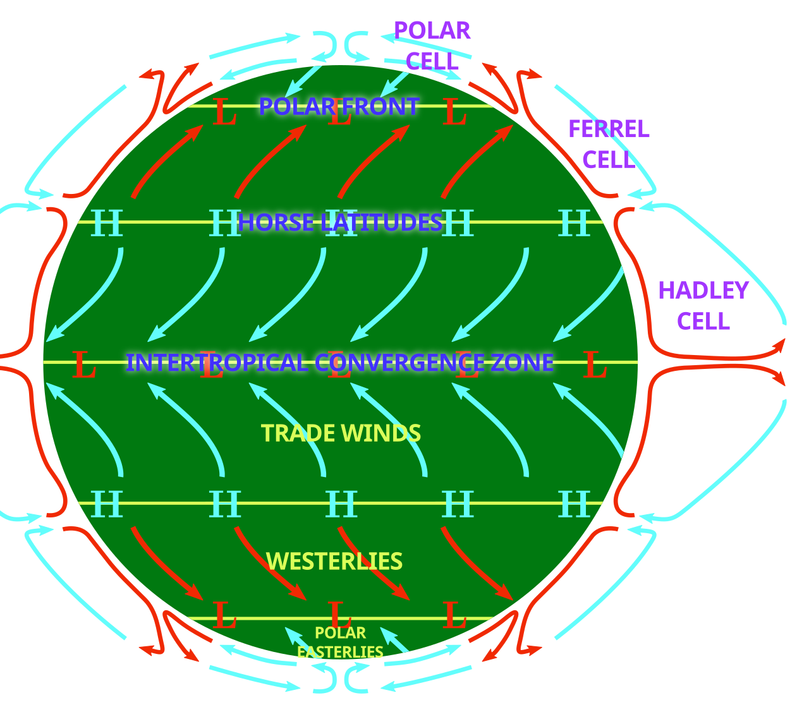
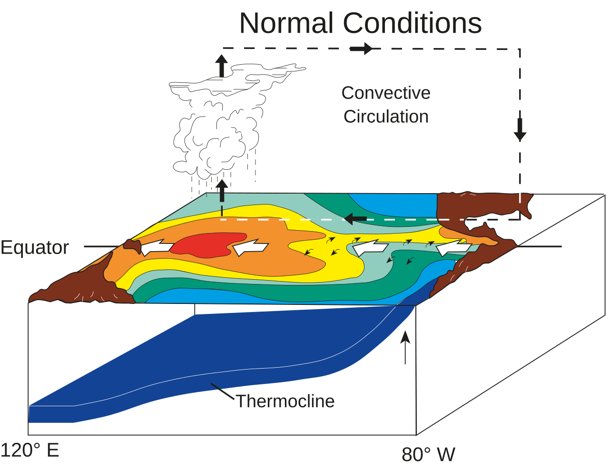

# IB Environmental Systems and Societies SL

## Table of Contents

1. [Topic 1: Foundations of Environmental Systems and Societies](#topic-1-foundations-of-environmental-systems-and-societies)
    1. [1.1: Perspectives](#11-perspectives)
    2. [1.2: Systems](#12-systems)
    3. [1.3: Sustainability](#13-sustainability)
2. [Topic 2: Ecology](#topic-2-ecology)
    1. [2.1: Individuals, Populations, Communities, and Ecosystems](#21-individuals-populations-communities-and-ecosystems)
    2. [2.2: Energy and Biomass in Ecosystems](#22-energy-and-biomass-in-ecosystems)
    3. [2.3: Biogeochemical Cycles](#23-biogeochemical-cycles)
    4. [2.4: Climate and Biomes](#24-climate-and-biomes)
    5. [2.5: Zonation, Succession, and Change in Ecosystems](#25-zonation-succession-and-change-in-ecosystems)
3. [Topic 3: Biodiversity and Conservation](#topic-3-biodiversity-and-conservation)
    1. [3.1: Biodiversity and Evolution](#31-biodiversity-and-evolution)

 

## Topic 1: Foundations of Environmental Systems and Societies

### 1.1: Perspectives

* Ways you can value something
    * **Instrumental**: means to a desired end
    * **Intrinsic**: assigned values; worth protecting
    * **Relational**: people-nature interactions and interactions of people via nature

* **Value indicators**: quantitative/qualitative, reflecting nature's importance

* **Indigenous/local knowledge systems**: traditional knowledge; diverse/grounded in sociocultural identity

* Types of worldviews
    * **Imperialistic**: science is to control nature
    * **Stewardship**: humans are to look after nature
    * **Romantic**: nature is valuable because it's beautiful
    * **Utilitarian**: nature can do a lot for humans

* **Environmental Value System (EVS)**: environmental perspectives
    * **Ecocentric**
        * Soft/self-reliant ecologists
        * Deep ecologists
        * Ecoterrorism
    * **Anthropocentric**
        * Environmental manager
    * **Technocentric**
        * Cornucopian

 

### 1.2: Systems

* Model components
    * **Boundary**: line between inside/outside the system
    * **Components**: parts; the boxes
    * **Processes**: flows of matter; the arrows
    * **Feedback**: outputs; influence equilibria
    * **Synergy**: emergent behavior
    * **Reductionism**
    * **Holism**: parts of a whole; interconnected

* Equilibria types
    * **Steady-state**: average condition is unchanged
    * **Dynamic**: balance between reversible processes
    * **Stable**
    * **Unstable**

* **Resilience vs. resistance**: resilience is getting back to normal, resistance is ability to ignore change

 

### 1.3: Sustainability

* **The Millennium Ecosystem Assessment (MA)**
    * Started 2001
    * Measured 24 environmental indicators
    * Was to assess consequences of ecosystem change for human wellbeing
    * Found that ecosystems have rapidly changed in the past 50 years; substantial loss of biodiversity

* **Ecological footprint (EF)**
    * Area of land/water required to sustainably provide resources
    * EF > area available = unsustainable

* **Biocapacity**: planet's productive land that can assimilate waste

* **Overshoot**: exceeding biocapacity

 

## Topic 2: Ecology

### 2.1: Individuals, Populations, Communities, and Ecosystems

* **Species (spp)**
    * Organisms that can interbreed/produce fertile young
    * Cross-breeding does not result in new spp; a hybrid

* **Population**: individuals of same species in same area at same time

* **Natural increase rate (NIR/RNI)**
    * $\text{NIR} = \dfrac{\text{birth rate} - \text{death rate}}{10}$
        * Birth/death rate are per 1000 individuals
    * Main cause of change is death or emigration

* **Taxonomy**: naming, conception, and classification of groups of organisms
    * **Dichotomous key**: identification of spp in binary steps
    * **Cladogram**: branching diagram; evolutionary relations

* Intra/interspecific and in/ex situ
    * **Intraspecific**: within a spp
    * **Interspecific**: between spp
    * **In situ**: within a spp's natural environment
    * **Ex situ**: outside of a spp's natural environment

* **Community**: group of populations interacting in a common habitat

* **Habitat**: natural environment a spp lives in

* **Niche**: set of abiotic/biotic conditions/resources necessary for an organism to survive
    * **Realized niche**: actual set of environmental conditions
    * **Fundamental niche**: full set of environmental conditions; theoretical included

* **Carrying capacity (K)**
    * Population of a spp an area can support without environmental degradation
    * $\text{EF} \propto \dfrac{1}{K}$

* **Density-dependent/-independent factors**: environmental conditions that regulate population growth based on how crowded a population is

* Population growth curves
    * **Linear**
    * **J-curve**: exponential
    * **S-curve**: logistic/sigmoidal

* **Verhulst equation**: models population growth with limited resources
    * $\frac{dN}{dt} = rN\left(1 - \frac{N}{K}\right)$
        * **N**: individuals
        * **r**: growth rate (NIR)

* **Lotka-Volterra competition equation**: model equation for the population growth of a species interacting with another
    * $\frac{dN_1}{dt} = r_1 N_1 \left(\frac{K_1 - N_1 - \alpha N_2}{K_1}\right) \quad \text{and} \quad \frac{dN_2}{dt} = r_2 N_2 \left(\frac{K_2 - N_2 - \beta N_1}{K_2}\right)$
        * **α/β**: competition coefficients

* **Biogeography equation**: represents equilibrium number of species from the Theory of Island Biogeography
    * $S = \frac{PI}{I + E}$
        * **P**: source pool of species available on nearby mainland; maximum possible number of species that could inhabit the island
        * **I**: maximum immigration rate
        * **E**: maximum extinction rate

* **Species-area relationship**: describes how the number of species increases as the size of a surveyed habitat grows
    * $S = cA^z \quad \text{or} \quad \log(S) = \log(c) + z\log(A)$
        * **c**: constant dependent on one spp in one unit area
        * **z**: gradient of the spp-area relationship in log-log space
        * **A**: habitat area

* **Malthusian K-model**
    * Exponential population vs. linear food
    * **Malthusian catastrophe**: population crossed food; population declines rapidly

* **Boserup (Qay's Theory) K-model**
    * Exponential population vs. stepwise food growth
    * Food pressure increases production

* **Transects**
    * Straight line
    * Object/natural feature

* **Quadrats**
    * Grids
    * Usually 1 square meter
    * Usually for population density

* **Kite graphs**: distribution along gradient

    

* **Lincoln-Petersen Index**
    * $N = \frac{M \times C}{R}$
        * **M**: captured/released first time
        * **C**: captured second time
        * **R**: recaptured second time

* **Ecosystem**: community with physical environment

* **Sankey diagrams**

    

* Stability factors
    * **Inertia**: resistance
    * **Resilience**
    * **Diversity**

* **Keystone (umbrella) species**: important to food chain/environment

 

### 2.2: Energy and Biomass in Ecosystems

* **Insolation (irradiance)**: solar radiation in area, including EM

* **Attenuation**: gradual loss of intensity

* Laws of thermodynamics
    * **Zeroth**: if two systems are in thermal equilibrium with a third, they are in equilibrium with each other
    * **Second**: entropy of a system will increase the longer that system is in place
    * **Third**: there is no practical means to reach absolute zero (0 K)

* Productivity
    * **Gross productivity (GP)**: total gain in biomass per unit area per unit time
    * **Net productivity (NP)**: gain by producers in energy or biomass per unit area per unit time

* Biomagnification vs. bioaccumulation
    * **Biomagnification**: across food chain
    * **Bioaccumulation**: across trophic level

* **Net/Gross Primary Productivity**
    * $NPP = GPP - R$
        * **Net Primary Productivity (NPP)**: harvestable energy; biomass
        * **Gross Primary Productivity (GPP)**: energy from photosynthesis
        * **Respiratory losses (R)**: accounts for plant respiration

* **Net/Gross Secondary Productivity**
    * $NSP = GSP - R$
    * $GSP = \text{food eaten} - \text{fecal loss}$

* **Maximum Sustainable Yield (MSY)**: highest rate equal to NPP/NSP

* **Carrying capacity and thermodynamics**: second law; closest to producers have higher carrying capacity

 

### 2.3: Biogeochemical Cycles

* **CHONPS**: required by life: carbon, hydrogen, oxygen, nitrogen, phosphorus, sulfur

* **Sequestration**: capturing and storing

* **Distillation**: separation/purification

* **Ammonification**: decomposers break down organic nitrogen into ammonia

* **Nitrogen fixation**: converting atmospheric nitrogen into nitrate/ammonia

* **Nitrification**: oxidation of ammonia; ammonia to nitrite, nitrite to nitrate

* **Denitrification**: removal of oxygen from nitrate; nitrate to dinitrogen

* **Storages**: where energy, matter, or water is stored for a period of time

* **Carbon cycle**: producers; fast

    

* **Nitrogen cycle**: decomposers and lightning; fast

    

* **Phosphorus cycle**: sediments; slow

    

* **Haber-Bosch process**: synthesizing ammonia from atmospheric nitrogen/hydrogen

* **Residence time equation**
    * $\tau = \frac{m}{F_{out} + L + D}$
        * **τ**: lifetime of atmospheric species
        * **m**: mass
        * **Fout**: sum of flow out of system
        * **L**: chemical loss in reactions
        * **D**: deposition

 

### 2.4: Climate and Biomes

* **Climatology**: climate; weather in area; long-term

* **Meteorology**: weather; short-term

* **Biomes**: large geographic areas with unique climate

* **Holdridge life zones**

    

* **Climatographs**

    

* **Tricellular model**: longitudinal differences
    * Polar cell
    * Ferrel cell
    * Hadley cell

    

* **Rain shadows**: other side of mountains where rain is blocked from

* Climate types
    * **Tropical**
        * **Seasonal**: high rainfall; dry seasons; monsoons
        * **Equatorial**: higher rainfall; no seasons; high temperature
    * **Temperate**: 4 seasons
        * **Maritime**: dry summer; mild-wet winters
        * **Continental**: greater temperatures inland
    * **Polar**

* **Walker circulation**: latitudinal differences
    * Stronger during La Niña
    * Weaker during El Niño

    

* **El Niño Southern Oscillation (ENSO)**
    * 3 phases; 2–7 years
        * **El Niño**: warm; 9–12 months
        * **La Niña**: cool; 1–3 years
    * Changes due to surface temperature, atmospheric pressure, and other weather patterns

 

### 2.5: Zonation, Succession, and Change in Ecosystems

* **Zonation**: distribution of species according to parameters, characterized by dominant species; change in spp along environmental gradient

* **Soil horizons**: OAEBCR
    * **O**: organic
    * **A**: topsoil
    * **E**: elevation
    * **B**: subsoil
    * **C**: parent rock
    * **R**: bedrock
    
* Types of transects
    * Point sampling
    * Continuous belt
    * Interrupted belt
    
* **R-strategists**: rapid reproduction, smaller

* **K-strategists**: slower reproduction, bigger

* **Plagioclimax**: human-impacted climax community

* **Diffusion**: populations expanding

* **Secular migration**: slow biological dispersal

* Succession stages
    * **Early**: diffusion and secular migration; r-strategists
    * **Intermediate**: k-strategists
    * **Late**: climax community; dynamic/steady-state equilibrium; plagioclimax
    
* **Seral communities**: communities succeeding each other in a location; seral stages
    * **Hydrosere**: water
    * **Lithosere**: land
    * **Psammosere**: sand
    * **Xerosere**: dry area
    * **Halosere**: marsh; saline bodies

 

## Topic 3: Biodiversity and Conservation

### 3.1: Biodiversity and Evolution

* 